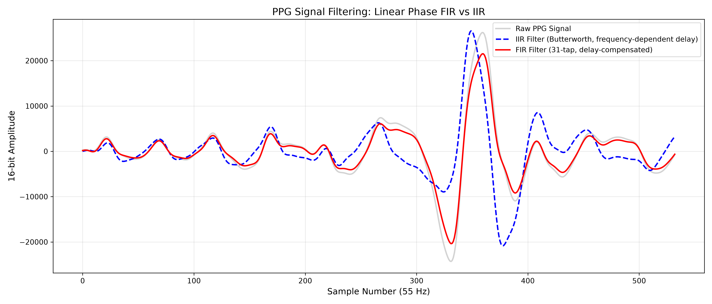

[](https://doi.org/10.5281/zenodo.23758178)
# Open-Source FPGA FIR Architecture Comparison for Wearable PPG

Verilog implementations of **direct**, **symmetric-folded** and **run-time-selectable** linear-phase FIR filters (5, 15 and 31 taps) for photoplethysmography (PPG) on an Artix-7 FPGA, with post-route Vivado reports, a bit-exact golden-model check, and a timing comparison against a causal Butterworth IIR.

## What this repository shows

Linear-phase FIR filters keep waveform timing intact (constant group delay), but a direct-form implementation needs one multiplier per nonzero coefficient. Because the coefficients are symmetric, samples that share a coefficient can be added first (symmetric folding), roughly halving the multipliers. This repository measures what that buys on a concrete device, with all RTL, scripts and reports included.

## Hardware results (Artix-7 xc7a200tfbg676-2, Vivado 2026.1, post-route)

Single clock constraint of 50 ns (20 MHz). Estimated Fmax = 1 / (50 ns - WNS).

| Architecture | Taps | DSP48E1 | LUTs | Regs | WNS (ns) | Est. Fmax (MHz) | Dynamic (mW) | Total (mW) |
| :--- | :--- | ---: | ---: | ---: | ---: | ---: | ---: | ---: |
| Folded | 5 | 3 | 31 | 96 | +37.152 | 77.8 | 4 | 135 |
| Folded | 15 | 7 | 33 | 256 | +31.309 | 53.5 | 5 | 136 |
| **Folded** | **31** | **14** | **33** | **496** | **+21.048** | **34.5** | **7** | **138** |
| Direct | 31 | 27 | 41 | 496 | +2.798 | 21.2 | 10 | 141 |
| Run-time folded | 5/15/31 | 15 | 261 | 512 | +18.672 | 31.9 | 8 | 139 |

Key points:

- **Folding at 31 taps:** DSPs fall from 27 to 14 (48%). The critical path is a combinational chain of cascaded DSP blocks (27 vs 14 long), so estimated Fmax rises from 21.2 to 34.5 MHz.
- **Power, honestly:** the vectorless dynamic estimate drops from about 10 to 7 mW (roughly 30%, but values are rounded to 1 mW and the confidence level is Low). Every design includes a constant 3 mW of I/O power. **Total** on-chip power changes only from 141 to 138 mW (about 2%) because the large device has 131 mW of static power. Power was estimated at 20 MHz with default activity, so these are not wearable power budgets.
- **Cost of run-time flexibility:** 228 more LUTs than the fixed folded 31-tap design (261 vs 33), one more DSP (15; coefficient lane 10 is zero in all three modes, so 16 - 1), and an estimated Fmax 2.6 MHz lower. Versus the direct 31-tap design it saves 12 DSPs.
- **Fmax is an estimate:** it comes from a relaxed constraint, with an un-pipelined DSP chain and unconstrained I/O. The direct 31-tap result needs `MAX_TAPS=31` (the module default is 15).

## Verification

The folded 31-tap RTL is compared with a Python integer golden model (same Q1.15 coefficients, rounding `(acc + 2^14) >> 15`, and saturation).

- **Real PPG data, two windows:** 549 of 549 compared samples match (0 mismatches) on both the household-activity window (session_001) and the rest window (session_004). The testbench logs the output before each clock edge, so the correct comparison offset is one sample (`verilog_out[i+1] == py_out[i]`). All other offsets from -3 to +3 give 542 to 548 mismatches.
- **Saturation stress test:** 1000 directed and random samples. The golden model clamps 9 times high and 9 times low (all in the directed region). RTL matches on 999 of 999 compared samples.
- **Other architectures:** not RTL-simulated. A structural Python check (coefficients parsed from the `.v` files) shows folded equals direct for 5, 15 and 31 taps and for every run-time tap mode on 3000 random full-scale samples.
- The golden model shares coefficients, rounding and saturation convention with the RTL. It validates the folding arithmetic and the saturation path; it is not an independent specification of the filter.

## What the filters are (and are not)

These are low-order filters designed for a 0.5-5 Hz target band at 55 Hz sampling. In practice they are **low-pass dominant**:

| Gain at | 0 Hz | 0.5 Hz | 1 Hz | 2 Hz | 5 Hz | 8 Hz |
| :--- | ---: | ---: | ---: | ---: | ---: | ---: |
| 5-tap | 1.04 | 1.03 | 1.03 | 1.02 | 0.92 | 0.77 |
| 15-tap | 1.15 | 1.14 | 1.13 | 1.07 | 0.68 | 0.20 |
| 31-tap | 0.77 | 0.79 | 0.83 | 0.96 | 0.54 | 0.00 |

They do **not** remove baseline wander. A sharp 0.5 Hz high-pass edge at 55 Hz sampling would need several hundred taps.

## Timing behavior versus a causal IIR

The logged FIR output lags its input by 17 samples (15 group delay + 1 hardware latency + 1 testbench log offset). After removing it, the FIR is compared with a zero-phase reference (forward-backward Butterworth) on two 550-sample windows, together with the causal 2nd-order Butterworth band-pass IIR.

| | Rest: FIR | Rest: IIR | Household: FIR | Household: IIR |
| :--- | :--- | :--- | :--- | :--- |
| Whole-window cross-correlation lag | 0 | -2 | 0 | -6 |
| Reference peaks matched | 10 of 10 | 10 of 10 | 9 of 11 | 9 of 11 |
| Error within 8-sample gate (mean ± std) | +0.2 ± 0.4 (n = 10) | -0.1 ± 0.3 (n = 10) | 0.0 ± 0.5 (n = 9) | 0.0 ± 1.3 (n = 8) |
| Max error within gate | 1 | 1 | 1 | 2 |
| Peaks outside the gate | 0 | 0 | 0 | 1 (-10 samples) |
| Extra unmatched output peaks | 0 | 1 (sample 3, filter start-up) | 0 | 0 |

The FIR is within one sample on all 19 matched peaks, as expected from constant group delay. On the clean rest window the causal IIR is just as accurate. On the household window it is within two samples on eight of nine peaks, but shows a whole-window lag of -6 samples and one peak shifted by 10 samples on a large low-frequency transient. The IIR's phase delay is negative (a lead) below about 1.5 Hz and positive above, so its timing error appears when low-frequency content shapes a peak. The FIR's advantage is a guaranteed, input-independent timing relationship, not a measured advantage on every window.



Note that the 31-tap FIR has a 15-sample group delay (about 0.27 s at 55 Hz). The delay can be removed exactly offline, but a real-time system still waits for it.

## Limitations

- Two 550-sample windows of one channel (one rest, one household activity): this shows timing preservation, not noise suppression, and the IIR deviates visibly only on the household window.
- The test data is a Kaggle upload with no DOI or linked paper. Its windows are preprocessed and individually normalized, and agreement with the ECG heart rate was checked by dominant frequency, not waveform shape.
- Low-order, low-pass dominant filters with no baseline-wander rejection.
- RTL simulation covers the 31-tap folded design only.
- Fmax and power values are Vivado estimates (relaxed constraint, vectorless power with Low confidence). No on-board measurement was performed and no IIR was implemented in hardware, so no area or power comparison with IIR is claimed.
## Citation

If you use this work, please cite the archived release: **[10.5281/zenodo.23758178](https://doi.org/10.5281/zenodo.23758178)**. See `CITATION.cff`.cff
## Repository structure

```text
rtl/           Verilog: direct (buildtime), folded 5/15/31, run-time folded
simulation/    Testbenches (tb_ppg.v, tb_sat.v, ...) and .hex input vectors
python/        Coefficient generation, data prep, verification, plotting
reports/       Vivado post-route utilization, timing and power reports (15 files)
images/        Result plots
